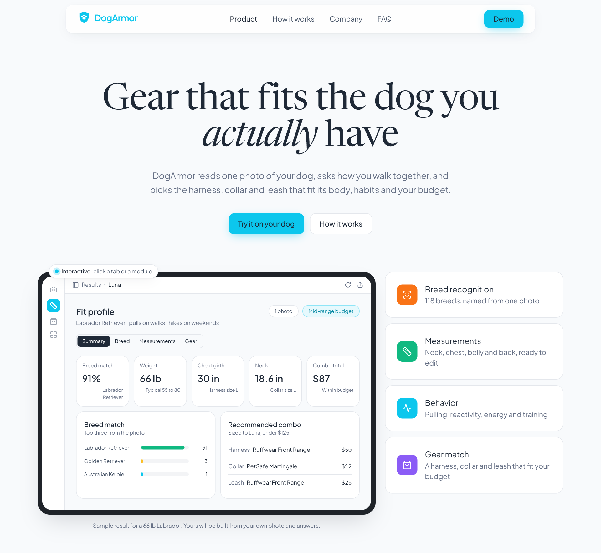
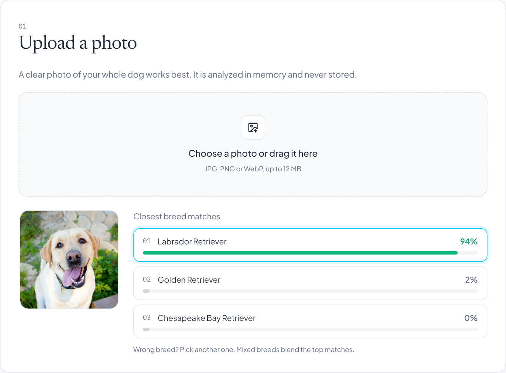
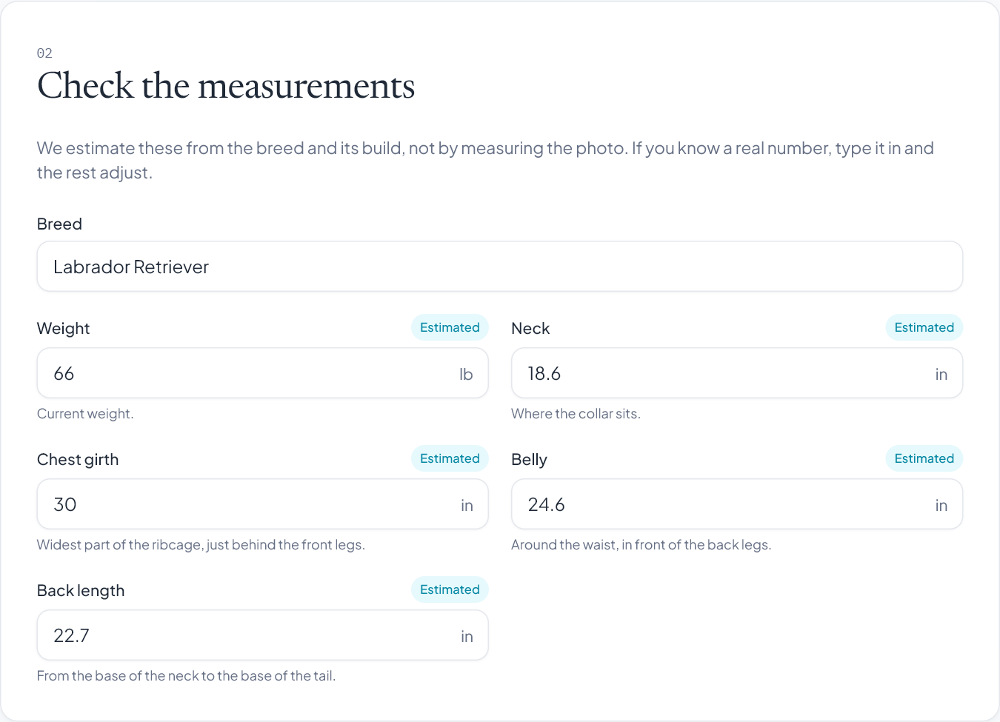
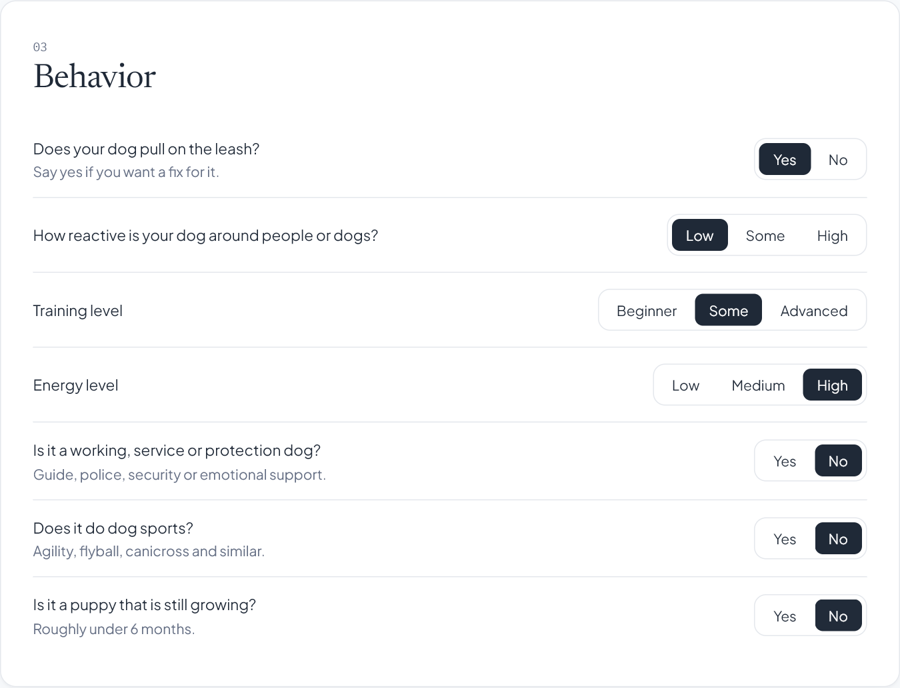
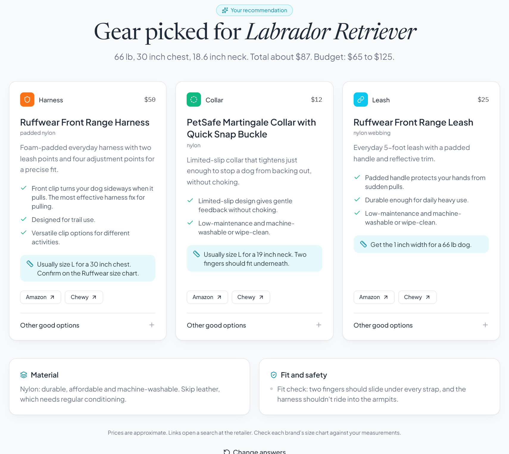

<div align="center">


# DogArmor

**The right harness, collar and leash for your dog, picked from one photo and a few questions.**

[**Try it live: dogarmor.up.railway.app**](https://dogarmor.up.railway.app)

</div>



## What it does

- **Recognizes your dog** from a single photo (118 breeds, blended for mixes) and checks there is a dog in the photo at all.
- **Estimates the measurements that decide fit**: weight, neck, chest girth, belly and back length. You can replace any of them with a real measurement.
- **Picks a harness, collar and leash** that fit those measurements, your dog's behavior, where you walk and your budget, and explains every pick.

No account needed. Photos are analyzed in memory and never stored.

## How to use it

### 1. Upload a photo

Use a clear photo of your whole dog. DogArmor shows its top three breed matches. Click a different one if it got it wrong.



### 2. Check the measurements

Measurements are estimated from the breed and its build, not measured from the photo. Fields marked **Estimated** can be overwritten. Enter a real weight and the girths recalculate around it.



### 3. Answer a few questions

Thirteen quick questions about behavior (pulling, reactivity, training, energy), activities (hiking, hunting, water, sports), climate and gear upkeep, then pick a budget.



### 4. Get your combo

You get one harness, one collar and one leash. Each comes with the reasons it was chosen, the size to order, two alternatives and links to Amazon and Chewy, plus material and safety notes for your dog.



## How it works

| Stage | What happens |
|---|---|
| **Breed recognition** | EfficientNetV2-S (ImageNet weights) exported to ONNX and run with ONNX Runtime, about 20 ms per photo on CPU. Its non-dog classes double as a "no dog found" check. |
| **Measurements** | Each breed has a typical adult weight range and build (standard, sighthound, stocky, long-backed). Girths and back length scale with the cube root of weight, adjusted for build. Mixed breeds blend the top matches by confidence. |
| **Recommendation** | A curated catalog of 36 products, each tagged with features, material, price and fit range. Answers add weight to the tags that matter for your dog. Products that don't fit or exceed the budget are filtered out, and the highest scoring harness, collar and leash win. |
| **Safety rules** | No head halters for flat-faced or toy breeds, harness-first advice for small dogs, martingales for sighthounds. |

**Accuracy:** on everyday dog photos the model names the exact breed 81% of the time, and the right breed is in its top three 97% of the time.

**Limits:** a single photo has no scale, so measurements are breed-based estimates. For the most precise sizing, measure your dog and enter the numbers. Prices are typical and change often.

## Run it locally

Requires Python 3.12.

```bash
python -m venv .venv
source .venv/bin/activate      # Windows: .venv\Scripts\activate
pip install -r requirements.txt
python run.py                  # http://localhost:5000
```

| Task | Command |
|---|---|
| Run tests | `pip install pytest && python -m pytest` |
| Rebuild CSS after editing templates | `npm install && npm run build:css` |
| Regenerate the model file | `pip install torch torchvision onnx onnxscript && python -m src.features.export_onnx` |

## API

| Endpoint | Purpose |
|---|---|
| `POST /api/analyze` | Multipart `image` → breed matches, dog check and measurement estimate |
| `GET /api/estimate?breed=&weight=` | Measurements for a breed and/or known weight |
| `POST /api/recommend` | JSON profile → harness, collar, leash, alternatives, extras and notes |
| `GET /api/breeds` | All supported breed names |
| `GET /healthz` | Health check |

## Deployment

Production runs on [Railway](https://railway.com) from the `Dockerfile` (gunicorn). Pushes to `main` deploy automatically. Service settings live in `.railway/railway.ts`: preview changes with `railway config plan` and apply them with `railway config apply`. To deploy manually, run `railway up --service web`.

## Project structure

```
app/
  routes.py               pages and JSON API
  templates/              Jinja templates (Tailwind)
  static/                 compiled CSS, demo.js, images
src/features/
  breed_predictor.py      ONNX inference and measurement estimates
  gear_recommender.py     scoring engine
  export_onnx.py          builds models/breed_classifier.onnx
data/processed_data/
  breed_profiles.csv      weight range, build and coat for 118 breeds
  gear_catalog.json       product catalog
models/                   breed_classifier.onnx
tests/                    pytest suite
```

## Team

Built by **Vihaan Kesharwani** (design and frontend) and **Anto Francis** (models and backend).
Questions or business inquiries: [dogarmorteam@gmail.com](mailto:dogarmorteam@gmail.com)

Image and dataset credits are in [Citations.md](Citations.md).
